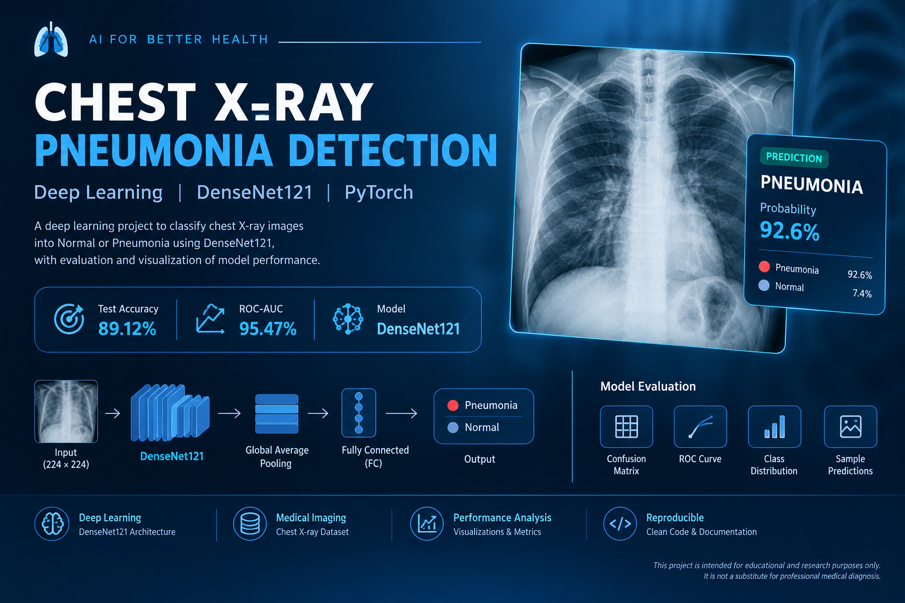

# Chest X-Ray Pneumonia Detection using DenseNet121

## Overview
This project uses deep learning and computer vision to classify chest X-ray images into two categories:
- NORMAL
- PNEUMONIA

The model uses DenseNet121 with transfer learning and fine-tuning using PyTorch.

## Objectives
- Classify chest X-ray images into NORMAL and PNEUMONIA.
- Evaluate model performance using accuracy, precision, recall, F1-score, and ROC-AUC.
- Save the trained model and evaluation results for reproducibility.

## Tech Stack
- Python
- PyTorch
- Torchvision
- NumPy and Pandas
- Scikit-learn
- Matplotlib

## Dataset
The project uses the Chest X-Ray Images (Pneumonia) dataset.

Dataset source:
https://www.kaggle.com/datasets/paultimothymooney/chest-xray-pneumonia

The dataset contains NORMAL and PNEUMONIA chest X-ray images.
The dataset is not included in this repository.

## Model
- Architecture: DenseNet121
- Approach: Transfer learning and fine-tuning
- Input size: 224 x 224
- Number of classes: 2
- Framework: PyTorch

## Test Results
Evaluation on 624 test images using a probability threshold of 0.5:

| Metric | Result |
|---|---:|
| Accuracy | 83.65% |
| ROC-AUC | 95.34% |
| NORMAL recall (specificity) | 57.26% |
| PNEUMONIA recall (sensitivity) | 99.49% |

### Confusion Matrix

| Actual / Predicted | NORMAL | PNEUMONIA |
|---|---:|---:|
| NORMAL | 134 | 100 |
| PNEUMONIA | 2 | 388 |

The model detects most PNEUMONIA images, but it also produces false positives on NORMAL images. This limitation must be considered when interpreting the results.

## Project Structure

```text
Lung disease detection/
├── data/              # Dataset (not included in Git)
├── models/            # Saved model checkpoints
├── notebooks/         # Experiments and analysis
├── reports/           # Project reports
├── results/           # Evaluation metrics and reports
├── src/               # Reusable source code
└── README.md
```

## Setup

Create and activate a virtual environment on Windows:

```powershell
python -m venv .venv
.\.venv\Scripts\Activate.ps1
```

Install the required packages:

```powershell
pip install torch torchvision numpy pandas scikit-learn matplotlib tqdm
```

## Notes
- This project is for educational and research purposes.
- It is not a medical diagnostic device.
- Predictions should not be used as a substitute for professional medical assessment.
